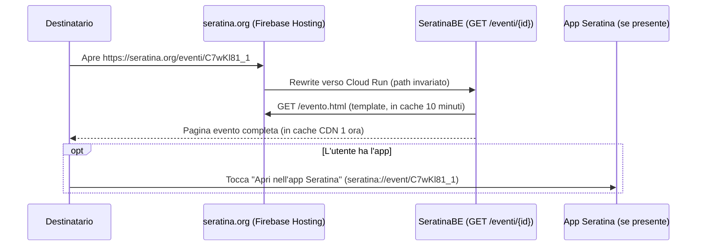

# Deep Linking & Pagina Evento — SeratinaWeb 🔗

Questo documento descrive come il sito gestisce i link agli eventi condivisi e la pagina di ogni evento (`/eventi/{id}`).

---

## 1. Perché un Link Web

Un evento condiviso dall'app può essere aperto da qualsiasi dispositivo: smartphone con o senza l'app, computer, tablet. Lo schema dell'app (`seratina://event/{id}`) funziona solo dove l'app è installata, quindi il link condiviso è sempre un URL web HTTPS.

---

## 2. Il Link dell'Evento (`https://seratina.org/eventi/{id}`)

```text
https://seratina.org/eventi/C7wKl81_1
```

È l'unico indirizzo di un evento: lo usano l'app, il pulsante *"Condividi serata"*, le card dell'elenco, la newsletter e la sitemap, ed è l'URL canonico per i motori di ricerca (vedi [seo.md](seo.md)).

Firebase Hosting inoltra `/eventi/**` al backend su Cloud Run. Il backend scarica il template `evento.html` di questo repo (header, footer e stili del sito), inserisce head e contenuto della serata e restituisce la pagina completa.



La pagina **non** apre l'app automaticamente: l'apertura avviene solo con il pulsante, così resta leggibile da browser e motori di ricerca.

---

## 3. La Pagina Evento

1. **Struttura**: header e footer del sito (dal template `evento.html`), breadcrumb `Home › Eventi › {città} › {titolo}`.
2. **Contenuto**:
   - Locandina intera, senza ritaglio.
   - Badge di categoria (`Club`, `Musica`, `Festival`, `Aperitivo`, `Arte`) e badge *"Evento concluso"* se la data è passata.
   - Titolo come `<h1>` nascosto alla vista (è già nella locandina, resta per Google e screen reader), locale e città.
   - Data in italiano, orario di inizio, locale, indirizzo e pulsante *"Mappe"* (Google Maps).
   - Ingresso: `Gratuito`, prezzo singolo (`€X`) oppure *"A partire da €X"* se ci sono più tariffe diverse. Con più di una tariffa, la sezione *"Tipologie di ingresso"* mostra una card a forma di biglietto per tariffa, dalla più economica (badge *"Più conveniente"*), con il pulsante *"Acquista biglietti"* se c'è il link di vendita.
   - Descrizione completa dell'evento.
   - **Il locale**: logo (o l'iniziale se manca), nome, indirizzo, città, regione, `@username`, link a Google Maps e al profilo Instagram.
   - **Prossime serate al locale**: tutte le serate future dello stesso locale, con le stesse card dell'elenco. Sono tutte nell'HTML; se sono più di 6 si vedono le prime 6 e *"Mostra tutte le N serate"* apre le altre senza altre richieste al server. Link *"Tutti gli eventi a {città}"* (`eventi.html?city=...`).
3. **Pulsanti**:
   - *"Apri nell'app Seratina"*: `seratina://event/{id}`.
   - *"Condividi serata"*: Web Share API se disponibile, altrimenti copia di `https://seratina.org/eventi/{id}` negli appunti.
4. **Evento inesistente**: risposta 404 con `noindex, follow`, messaggio *"Serata non trovata"* e pulsante verso l'elenco.

Lo script del template gestisce solo il menu mobile, il pulsante Condividi e *"Mostra tutte le serate"*; tutto il resto è HTML generato dal server.

---

## 4. Link Legacy (`https://seratina.org/?event={id}`)

Le versioni dell'app fino alla v1.5.0 condividono `https://seratina.org/?event={id}`. Uno script in testa a `index.html` li reindirizza subito (`location.replace`) a `/eventi/{id}`.

I vecchi link `eventi.html?event={id}` non hanno redirect: aprono l'elenco eventi. Nessuno di quegli URL era indicizzato.
