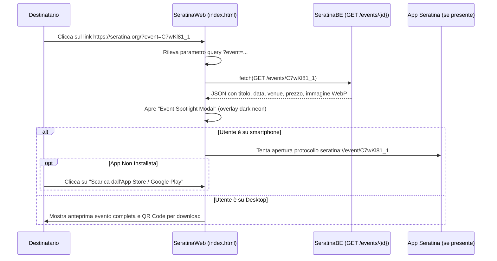

# Deep Linking & Event Spotlight Modal — SeratinaWeb 🔗

Questo documento descrive il funzionamento del sistema universale di condivisione eventi e dell'**Event Spotlight Modal** integrato in `SeratinaWeb`.

---

## 1. Il Problema della Condivisione Cross-Platform

Quando un utente tocca *"Condividi"* all'interno dell'app mobile Seratina, il link generato può essere aperto da qualsiasi dispositivo:
- Uno smartphone con l'app installata.
- Uno smartphone **senza** l'app installata.
- Un computer desktop o tablet.

I custom scheme proprietari (es. `seratina://event/123`) falliscono miseramente se aperti in un normale browser o se l'app non è presente, restituendo un errore di protocollo non supportato.

---

## 2. Il Flusso del Link Universale (`https://seratina.org/?event={id}`)

Per risolvere il problema alla radice, Seratina genera un link web universale standard HTTPS:
```text
https://seratina.org/?event=C7wKl81_1
```



---

## 3. Specifiche dell'Event Spotlight Modal

All'apertura della landing page con il parametro `?event=ID`:
1. **Fetch dei Dati in Tempo Reale**: il client invoca in modo trasparente `GET /events/{id}` su `SeratinaBE`.
2. **Presentazione Grafica Notturna**:
   - Locandina evento a tutta altezza con effetto *ambient blur* sullo sfondo (`backdrop-blur-xl`).
   - Badge neon di categoria (`Club`, `Musica`, `Aperitivo`, `Festival`, `Arte`).
   - Data formattata in italiano, orario di inizio, nome del locale e indirizzo.
   - Badge del prezzo (`Da €X` o `Omaggio`).
3. **Pulsante Primario Call-to-Action**:
   - Su dispositivi mobili: *"Apri nell'App Seratina"* (con link a `seratina://event/{id}`).
   - Fallback secondario: badge ufficiali di download da Apple App Store e Google Play Store.
