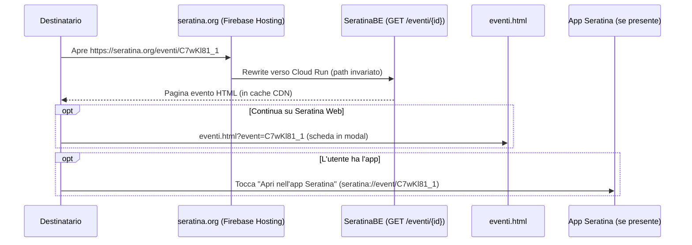

# Deep Linking & Event Spotlight Modal — SeratinaWeb 🔗

Questo documento descrive come il sito gestisce i link agli eventi condivisi e la scheda evento (**Event Spotlight Modal**).

---

## 1. Perché un Link Web

Un evento condiviso dall'app può essere aperto da qualsiasi dispositivo: smartphone con o senza l'app, computer, tablet. Lo schema dell'app (`seratina://event/{id}`) funziona solo dove l'app è installata, quindi il link condiviso è sempre un URL web HTTPS.

---

## 2. Il Link di Condivisione (`https://seratina.org/eventi/{id}`)

```text
https://seratina.org/eventi/C7wKl81_1
```

È il link condiviso dall'app, dal pulsante *"Condividi serata"* della scheda web e dalla newsletter, ed è l'URL canonico della serata per i motori di ricerca (vedi [seo.md](seo.md)). Firebase Hosting lo inoltra al backend, che restituisce una pagina HTML completa: locandina, data, locale, descrizione, meta tag, Open Graph e schema `Event`.



La pagina **non** apre l'app automaticamente: l'apertura avviene solo con il pulsante, così resta leggibile da browser e motori di ricerca. Se l'evento non esiste risponde 404 con `noindex`; se è passato resta visibile con il badge "Evento concluso".

---

## 3. La Scheda Evento (`eventi.html`)

1. **Dati**: aperta da una card usa i dati già caricati; aperta da URL diretto chiama `GET /events/{id}`. Se l'evento non esiste o la chiamata fallisce compare il popup *"Evento non trovato"* (`#notFoundModal`): chiudendolo si rimuove `?event` dall'URL e resta l'elenco serate.
2. **Contenuto**:
   - Locandina dell'evento con badge del prezzo.
   - Badge di categoria (`Club`, `Musica`, `Festival`, `Aperitivo`, `Arte`) accanto al titolo.
   - Data in italiano, orario di inizio, locale, indirizzo e pulsante *"Mappe"* (Google Maps).
   - Ingresso: `Gratuito`, prezzo singolo (`€X`) oppure *"A partire da €X"* se ci sono più tariffe diverse, con l'elenco delle tariffe sotto.
   - Descrizione dell'evento.
3. **Pulsanti**:
   - *"Apri nell'app Seratina"*: `seratina://event/{id}`.
   - *"Condividi serata"*: Web Share API se disponibile, altrimenti copia del link negli appunti.
4. **URL e SEO**: all'apertura l'URL diventa `?event=ID` e la pagina aggiorna `<title>`, description, Open Graph e schema `Event`; canonical e `og:url` puntano a `https://seratina.org/eventi/ID`. Alla chiusura tornano i tag della pagina elenco.
5. **Condivisione**: *"Condividi serata"* condivide `https://seratina.org/eventi/ID`.

---

## 4. Link Legacy (`https://seratina.org/?event={id}`)

I link condivisi con le versioni dell'app fino alla v1.5.0 puntano alla home. Uno script in testa a `index.html` li reindirizza subito (`location.replace`) a `/eventi/{id}`, la pagina evento dei link nuovi. Nessuna apertura automatica dell'app: si apre solo col pulsante *"Apri nell'app Seratina"* (vedi sezione 2).

I nuovi link usano sempre `/eventi/{id}`. I link `eventi.html?event={id}` già condivisi continuano a funzionare: aprono la scheda in modal e hanno canonical verso `/eventi/{id}`.
